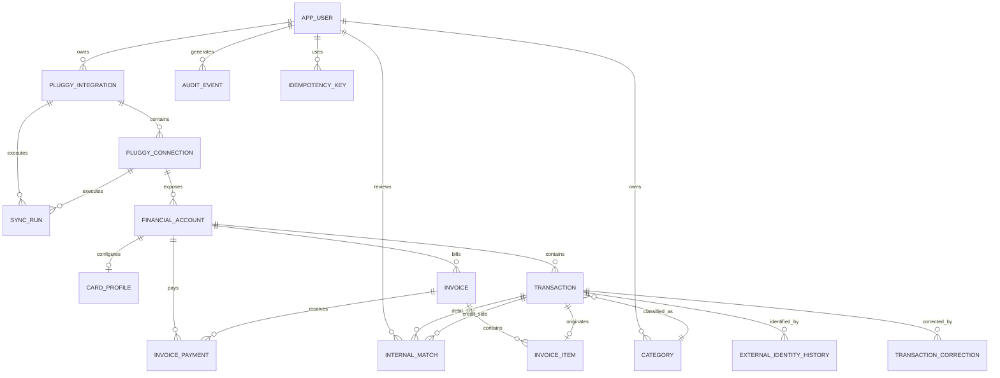

# Data Model: MVP de Finanças Pessoais Familiares

**Data**: 2026-10-22

**Spec**: [spec.md](./spec.md)

**Plano**: [plan.md](./plan.md)

## 1. Convenções

- Todos os IDs são `uuid` gerados pela aplicação.
- Todas as tabelas mutáveis têm `created_at`, `updated_at` e `version`
  (locking otimista), salvo indicação contrária.
- Datas de calendário usam `date`; instantes usam `timestamptz` em UTC.
- Valores monetários usam `BigDecimal` na aplicação e são persistidos como
  ciphertext; a moeda é um metadado `char(3)` em texto claro. Registros com
  `currency != 'BRL'` são sinalizados e excluídos de totais consolidados até
  existir regra explícita de conversão.
- Toda tabela financeira tem `user_id` e uma chave única composta
  `(user_id, id)`. Filhos referenciam o pai por `(user_id, parent_id)`, o que
  impede associação cruzada no nível do banco.
- Nenhum controlador aceita `user_id` do cliente. O `user_id` vem da sessão
  autenticada.
- Campos marcados `[enc]` usam AES-256-GCM com versão de chave. Campos `[hmac]`
  usam HMAC-SHA-256 com chave de índice separada. Campos `[plain]` são metadados
  pesquisáveis.
- Ciphertext inclui `key_version` e AAD com `user_id`, tabela, coluna e ID do
  registro.
- Senhas usam Argon2id (m=19 MiB, t=2, p=1, salt 16 B, hash 32 B); parâmetros
  versionados junto ao hash e nunca persistidos de forma reversível.
- Migrações são SQL versionadas com Flyway. Migrações aplicadas não são
  editadas; mudanças destrutivas seguem expand/contract.

## 2. Diagrama de entidades do MVP



## 3. Entidades operacionais e de identidade

### 3.1 `app_user`

| Campo | Tipo | Classificação | Regra |
|---|---|---|---|
| `id` | uuid | plain | PK. |
| `username_normalized` | text | plain | único, minúsculo, 3–40 caracteres. |
| `username_display` | text | plain | preserva capitalização. |
| `password_hash` | text | hash | Argon2id; nunca reversível. |
| `status` | text | plain | `ACTIVE`, `DELETION_PENDING`, `DELETED`. |
| `deletion_requested_at` | timestamptz | plain | auditoria. |
| `deleted_at` | timestamptz | plain | tombstone. |
| `created_at`, `updated_at` | timestamptz | plain | auditoria. |
| `version` | bigint | plain | locking otimista. |

Regras:

- `username_normalized` é único globalmente.
- Usuário `DELETION_PENDING` não autentica.
- O tombstone de exclusão não contém dados financeiros.

### 3.2 `login_attempt`

| Campo | Tipo | Classificação | Regra |
|---|---|---|---|
| `id` | uuid | plain | PK. |
| `username_hash` | bytea | hmac | HMAC do username normalizado. |
| `ip_hash` | bytea | hmac | HMAC do IP; não armazenar IP bruto. |
| `attempted_at` | timestamptz | plain | janela de bloqueio. |
| `success` | boolean | plain | resultado. |
| `failure_reason` | text | plain | sanitizado (`BAD_CREDENTIALS`, `RATE_LIMITED`). |
| `blocked_until` | timestamptz | plain | fim do bloqueio persistido; nulo quando a tentativa não gerou bloqueio. |

Índices: `(username_hash, attempted_at)`, `(ip_hash, attempted_at)`.
Retenção: 30 dias.

### 3.3 `user_session`

Gerenciada pelo Spring Session JDBC. Contém ID opaco, principal, timestamps e
atributos de sessão. Não contém segredos Pluggy nem valores financeiros.
Expiração: 30 minutos de inatividade, 12 horas absolutas.

### 3.4 `audit_event`

| Campo | Tipo | Classificação | Regra |
|---|---|---|---|
| `id` | uuid | plain | PK. |
| `user_id` | uuid | plain | nullable em falha de login/registro. |
| `event_type` | text | plain | `LOGIN_SUCCESS`, `LOGIN_FAILURE`, `LOGIN_BLOCKED`, `AUTHORIZATION_DENIED`, `CSRF_REJECTED`, `PASSWORD_CHANGED`, `INTEGRATION_UPDATED`, `SYNC_FAILED`, `EXPORT_REQUESTED`, `ACCOUNT_DELETED`, etc. |
| `target_type`, `target_id` | text, uuid | plain | recurso afetado. |
| `metadata` | jsonb | plain | apenas IDs, códigos e contadores; nunca valores, descrições ou segredos. |
| `created_at` | timestamptz | plain | auditoria. |

Índice: `(user_id, created_at)`. Retenção: 1 ano.

### 3.5 `idempotency_key`

Aplica-se apenas a transações, itens de fatura e pagamentos de fatura (S-07). As
demais mutações não gravam nesta tabela.

| Campo | Tipo | Classificação | Regra |
|---|---|---|---|
| `id` | uuid | plain | PK. |
| `user_id` | uuid | plain | proprietário. |
| `key` | text | plain | header `Idempotency-Key`, 8–128 caracteres. |
| `method`, `path` | text | plain | operação. |
| `request_hash` | bytea | hmac | detecta reutilização com corpo diferente. |
| `response_status` | int | plain | replay. |
| `response_body_enc` | bytea | enc | corpo sanitizado para replay, quando necessário. |
| `created_at`, `expires_at` | timestamptz | plain | TTL de 24 h. |

Único: `(user_id, key)`. Limpeza por job.

## 4. Integração Pluggy

### 4.1 `pluggy_integration`

| Campo | Tipo | Classificação | Regra |
|---|---|---|---|
| `id` | uuid | plain | PK. |
| `user_id` | uuid | plain | FK `app_user(id)`. |
| `provider` | text | plain | `MEU_PLUGGY`. |
| `client_id_enc` | bytea | enc | Client ID da aplicação pessoal. |
| `client_secret_enc` | bytea | enc | Client Secret; não retorna à interface. |
| `encryption_key_version` | int | plain | versão da chave usada. |
| `status` | text | plain | `INCOMPLETE`, `ACTIVE`, `SYNCING`, `SYNCED`, `CREDENTIAL_FAILURE`, `ACTION_REQUIRED`, `AUTHORIZATION_EXPIRED`, `ITEM_UNAVAILABLE`. |
| `last_sync_attempt_at` | timestamptz | plain | operação. |
| `last_successful_sync_at` | timestamptz | plain | operação. |
| `last_error_code` | text | plain | código sanitizado. |
| `created_at`, `updated_at` | timestamptz | plain | auditoria. |
| `version` | bigint | plain | locking otimista. |

Único: `(user_id, provider)`. Um usuário tem uma integração Meu Pluggy.

### 4.2 `pluggy_connection` (item)

| Campo | Tipo | Classificação | Regra |
|---|---|---|---|
| `id` | uuid | plain | PK estável local; não muda com o itemId. |
| `user_id` | uuid | plain | proprietário. |
| `integration_id` | uuid | plain | FK `(user_id, integration_id)` para `pluggy_integration`. |
| `external_item_id_enc` | bytea | enc | itemId bruto. |
| `external_item_id_hash` | bytea | hmac | busca e unicidade. |
| `institution_name_enc` | bytea | enc | nome da instituição. |
| `status` | text | plain | espelha o estado do item e o estado local. |
| `consent_expires_at` | timestamptz | plain | `consentExpiresAt` quando disponível. |
| `next_auto_sync_at` | timestamptz | plain | `nextAutoSyncAt` quando disponível. |
| `last_sync_at` | timestamptz | plain | última leitura bem-sucedida. |
| `last_error_code` | text | plain | `USER_AUTHORIZATION_EXPIRED`, `LOGIN_ERROR`, etc. |
| `consecutive_failures` | int | plain | contador. |
| `created_at`, `updated_at` | timestamptz | plain | auditoria. |
| `version` | bigint | plain | locking otimista. |

Único: `(integration_id, external_item_id_hash)`. A troca de itemId atualiza
`external_item_id_enc/hash` no mesmo registro local, preservando o `id`.

### 4.3 `sync_job`

| Campo | Tipo | Classificação | Regra |
|---|---|---|---|
| `id` | uuid | plain | PK. |
| `user_id` | uuid | plain | proprietário; pode ser nulo em job de manutenção. |
| `integration_id` | uuid | plain | nullable. |
| `connection_id` | uuid | plain | nullable. |
| `job_type` | text | plain | `SYNC_INTEGRATION`, `SYNC_CONNECTION`, `RECALCULATE_INVOICE`, `RECONCILE`. |
| `status` | text | plain | `QUEUED`, `RUNNING`, `SUCCEEDED`, `FAILED`, `RETRY`. |
| `run_after` | timestamptz | plain | agendamento com jitter. |
| `attempts` | int | plain | tentativas. |
| `max_attempts` | int | plain | padrão 5. |
| `locked_by`, `locked_at` | text, timestamptz | plain | claim com `FOR UPDATE SKIP LOCKED`. |
| `payload_hash` | bytea | hmac | conteúdo do job, sem dados financeiros. |
| `last_error_code` | text | plain | sanitizado. |
| `created_at`, `updated_at` | timestamptz | plain | auditoria. |

Índice: `(status, run_after)`, `(user_id, created_at)`.

Recuperação (ADR-0004): no start, todo job `RUNNING` é considerado órfão (instância
única). A tentativa interrompida vira uma linha em `sync_run` com
`error_code=INTERRUPTED`, o job volta para `RETRY` (se ainda houver tentativas) ou
`FAILED`, e `SYNCING` é liberado na conexão/integração. Timeout em memória usa
`DELTA_SYNC_JOB_TIMEOUT` e grava `JOB_TIMEOUT`.

### 4.4 `sync_run`

| Campo | Tipo | Classificação | Regra |
|---|---|---|---|
| `id` | uuid | plain | PK. |
| `user_id` | uuid | plain | proprietário. |
| `integration_id` | uuid | plain | FK. |
| `connection_id` | uuid | plain | nullable. |
| `started_at`, `finished_at` | timestamptz | plain | duração. |
| `status` | text | plain | `SUCCESS`, `PARTIAL`, `EMPTY`, `AUTH_ERROR`, `RATE_LIMITED`, `TIMEOUT`, `FAILED`. |
| `read_count`, `created_count`, `updated_count`, `skipped_count`, `failed_count` | int | plain | contadores. |
| `duration_ms` | bigint | plain | desempenho. |
| `error_code` | text | plain | sanitizado; `IMPORT_MISSING_FIELDS` quando a leitura trouxe transações sem valor/data. |
| `correlation_id` | text | plain | rastreabilidade. |

Índices: `(user_id, started_at)`, `(integration_id, started_at)`.
Retenção: 90 dias.

### 4.5 Webhooks

Webhooks foram removidos em 2026-10-25 (S-04). Não há tabelas, endpoints,
segredos ou jobs de webhook no schema ativo desde a baseline
`V001__baseline.sql`; a atualização ocorre pela sincronização programada.

## 5. Contas, cartões e transações

### 5.1 `financial_account`

| Campo | Tipo | Classificação | Regra |
|---|---|---|---|
| `id` | uuid | plain | PK. |
| `user_id` | uuid | plain | proprietário. |
| `connection_id` | uuid | plain | nullable; nulo para conta manual; FK `(user_id, connection_id)`. |
| `origin` | text | plain | `IMPORTED`, `MANUAL`. |
| `type` | text | plain | `BANK`, `CREDIT`, `CASH`, `WALLET`, `UNKNOWN`; tipos não reconhecidos pelo provedor ficam `UNKNOWN`. |
| `subtype` | text | plain | `CHECKING_ACCOUNT`, `CREDIT_CARD`, etc. |
| `external_account_id_enc` | bytea | enc | nullable em conta manual. |
| `external_account_id_hash` | bytea | hmac | nullable em conta manual. |
| `institution_name_enc` | bytea | enc | nullable em conta manual. |
| `alias_enc` | bytea | enc | apelido. |
| `currency` | char(3) | plain | BRL inicialmente. |
| `balance_enc` | bytea | enc | saldo disponível/referência; para `CREDIT`, é snapshot/limite do cartão e NÃO entra no saldo atual consolidado. |
| `balance_reference_at` | timestamptz | plain | data do saldo. |
| `status` | text | plain | `ACTIVE`, `INACTIVE`, `UNAVAILABLE`, `CLOSED`; `INACTIVE` para conta manual desativada. |
| `last_sync_at` | timestamptz | plain | nullable. |
| `created_at`, `updated_at` | timestamptz | plain | auditoria. |
| `version` | bigint | plain | locking otimista. |

Restrições:

- Único `(user_id, id)`.
- Único `(connection_id, external_account_id_hash)` quando `origin=IMPORTED`.
- O saldo atual consolidado do dashboard soma apenas contas `BANK`, `CASH` e
  `WALLET` com status `ACTIVE`. Contas `UNKNOWN`, `INACTIVE`, `CLOSED` ou
  `UNAVAILABLE` não compõem o saldo atual, mas permanecem no histórico e nos
  relatórios do período em que tiveram movimento. Passivos de cartão são
  derivados de `invoice.outstanding_enc` e exibidos separadamente.
- `connection_id` obrigatório quando `origin=IMPORTED`.
- Conta manual `INACTIVE` NÃO DEVE receber novos lançamentos nem transferências;
  o histórico e os relatórios existentes permanecem disponíveis.
- O `type` da conta manual é imutável após a criação.
- `connection_id` nulo quando `origin=MANUAL`.
- Contas importadas que não aparecem em uma leitura completa de contas do item
  ficam `UNAVAILABLE`; transações e histórico são preservados e a conta sai dos
  saldos correntes. Se a conta reaparecer, o upsert a reativa.
- O estado da conexão é exposto por `connectionStatus` em cada conta/cartão,
  separado de `status` da conta.

### 5.2 `card_profile`

| Campo | Tipo | Classificação | Regra |
|---|---|---|---|
| `id` | uuid | plain | PK. |
| `user_id` | uuid | plain | proprietário. |
| `account_id` | uuid | plain | FK `(user_id, account_id)`. |
| `closing_day` | int | plain | 1–31. |
| `due_day` | int | plain | 1–31. |
| `credit_limit_enc` | bytea | enc | limite quando disponível. |
| `credit_balance_enc` | bytea | enc | crédito acumulado para faturas futuras; não compõe `income`, `expenses` ou `currentBalance`. |
| `brand` | text | plain | bandeira informada pelo provedor (ex.: VISA). |
| `level` | text | plain | nível informado pelo provedor (ex.: PLATINUM). |
| `last4_enc` | bytea | enc | últimos quatro dígitos do cartão, quando informados. |
| `available_credit_limit_enc` | bytea | enc | limite disponível oficial informado pelo provedor. |
| `source` | text | plain | `PROVIDER`, `USER`. |
| `created_at`, `updated_at` | timestamptz | plain | auditoria. |
| `version` | bigint | plain | locking otimista. |

Único: `(user_id, account_id)`. Só existe para `financial_account.type=CREDIT`.

### 5.3 `transaction`

| Campo | Tipo | Classificação | Regra |
|---|---|---|---|
| `id` | uuid | plain | PK. |
| `user_id` | uuid | plain | proprietário. |
| `account_id` | uuid | plain | FK `(user_id, account_id)`. |
| `category_id` | uuid | plain | nullable; FK `(user_id, category_id)`. |
| `source` | text | plain | `IMPORTED`, `MANUAL`. |
| `type` | text | plain | `DEBIT`, `CREDIT`, `TRANSFER`, `REFUND`, `CHARGEBACK`, `ADJUSTMENT`. |
| `status` | text | plain | `PENDING`, `POSTED`, `SOURCE_REMOVED`, `RECONCILED`; `SOURCE_REMOVED` é automático em leitura conclusiva e não vazia. |
| `posted_on` | date | plain | data efetiva. |
| `source_posted_on` | date | plain | data original da origem. |
| `currency` | char(3) | plain | BRL inicialmente. |
| `amount_source_enc` | bytea | enc | valor original da origem, preservando o sinal recebido. |
| `amount_effective_enc` | bytea | enc | valor efetivo assinado: negativo para saída, positivo para entrada. |
| `description_source_enc` | bytea | enc | descrição original. |
| `description_effective_enc` | bytea | enc | descrição corrigida/exibida. |
| `external_transaction_id_enc` | bytea | enc | nullable em manual. |
| `external_transaction_id_hash` | bytea | hmac | nullable em manual. |
| `dedup_key` | bytea | hmac | único por usuário quando importado. |
| `fingerprint` | bytea | hmac | reconciliação de ID alterado/recriado. |
| `related_transaction_id` | uuid | plain | nullable; FK `(user_id, related_transaction_id)`; obrigatório para reembolso/chargeback vinculado. |
| `adjustment_reason_enc` | bytea | enc | nullable; motivo explícito para `ADJUSTMENT`. |
| `edited_fields` | text[] | plain | nomes dos campos corrigidos; não valores. |
| `reconciliation_state` | text | plain | `NONE`, `PENDING_MATCH`, `MATCHED`, `SOURCE_REMOVED`; acompanha o `status` automático. |
| `provider_bill_month` | date | plain | nullable; primeiro dia do mês de `creditCardMetadata.billForecastDate`. Compras usam o próprio mês; pagamentos usam o mês anterior. |
| `created_at`, `updated_at` | timestamptz | plain | auditoria. |
| `version` | bigint | plain | locking otimista. |

Restrições e índices:

- Único `(user_id, dedup_key)` quando `source=IMPORTED`.
- Índices: `(user_id, posted_on desc, id)`,
  `(user_id, account_id, posted_on desc)`,
  `(user_id, category_id, posted_on desc)`,
  `(user_id, type, posted_on desc)`.
- `amount_effective_enc` e `description_effective_enc` são sempre preenchidos;
  para manual, iguais aos valores informados.
- O valor efetivo é assinado: negativo para saída e positivo para entrada; o
  `type` deve ser consistente com o sinal, e transferências entre contas
  próprias não entram em receitas/despesas.
- Reembolsos/chargebacks vinculados DEVEM apontar para uma transação do mesmo
  usuário e conta; o valor efetivo é positivo e a categoria é herdada. A
  transação original não é alterada.
- `PENDING` não compõe nenhum agregado financeiro. Apenas `POSTED` e
  `RECONCILED` entram em receitas, despesas, resultado, categorias, drill-down e
  totais de fatura. `PENDING→POSTED` atualiza o mesmo registro e entra uma única
  vez; `SOURCE_REMOVED` sai dos totais correntes sem apagar a linha.

### 5.4 `transaction_correction`

| Campo | Tipo | Classificação | Regra |
|---|---|---|---|
| `id` | uuid | plain | PK. |
| `user_id` | uuid | plain | proprietário. |
| `transaction_id` | uuid | plain | FK `(user_id, transaction_id)`. |
| `field_name` | text | plain | `description`, `posted_on`, `amount`, `category`, `notes`. |
| `old_value_enc` | bytea | enc | valor anterior quando aplicável. |
| `new_value_enc` | bytea | enc | novo valor. |
| `changed_at` | timestamptz | plain | auditoria. |

Índice: `(transaction_id, changed_at)`.

### 5.5 `external_identity_history`

| Campo | Tipo | Classificação | Regra |
|---|---|---|---|
| `id` | uuid | plain | PK. |
| `user_id` | uuid | plain | proprietário. |
| `transaction_id` | uuid | plain | FK `(user_id, transaction_id)`. |
| `account_id` | uuid | plain | FK `(user_id, account_id)`. |
| `source` | text | plain | `PLUGGY`. |
| `external_id_enc` | bytea | enc | ID bruto. |
| `external_id_hash` | bytea | hmac | busca. |
| `first_seen_at`, `last_seen_at` | timestamptz | plain | histórico. |

Único: `(user_id, source, account_id, external_id_hash)`. Permite que um novo ID
da origem aponte para a mesma transação local sem duplicar despesa.

### 5.6 `category`

| Campo | Tipo | Classificação | Regra |
|---|---|---|---|
| `id` | uuid | plain | PK. |
| `user_id` | uuid | plain | proprietário. |
| `name_enc` | bytea | enc | nome exibido. |
| `normalized_name_hash` | bytea | hmac | unicidade por usuário. |
| `kind` | text | plain | `INCOME`, `EXPENSE`, `TRANSFER`, `OTHER`. |
| `predefined_key` | text | plain | nullable; categorias do sistema. |
| `active` | boolean | plain | desativação sem apagar. |
| `created_at`, `updated_at` | timestamptz | plain | auditoria. |
| `version` | bigint | plain | locking otimista. |

Único: `(user_id, normalized_name_hash)`. Exclusão lógica; transações ficam sem
categoria ou são reatribuídas.

## 6. Faturas e reconciliação

### 6.1 `invoice`

| Campo | Tipo | Classificação | Regra |
|---|---|---|---|
| `id` | uuid | plain | PK. |
| `user_id` | uuid | plain | proprietário. |
| `card_account_id` | uuid | plain | FK `(user_id, card_account_id)`. |
| `cycle_start`, `cycle_end` | date | plain | ciclo local. |
| `closing_date`, `due_date` | date | plain | fechamento/vencimento. |
| `status` | text | plain | `OPEN`, `CLOSED`, `PARTIALLY_PAID`, `PAID`, `OVERDUE`. |
| `has_adjustments` | boolean | plain | indica ajuste manual em fatura fechada/paga. |
| `adjustment_count` | int | plain | quantidade de ajustes manuais. |
| `total_enc` | bytea | enc | total calculado. |
| `payments_total_enc` | bytea | enc | pagamentos. |
| `outstanding_enc` | bytea | enc | saldo devedor. |
| `applied_credit_enc` | bytea | enc | crédito acumulado de faturas anteriores aplicado a esta fatura; não inclui itens de crédito/estorno desta fatura e não compõe `income` nem `expenses`. |
| `minimum_payment_enc` | bytea | enc | quando disponível. |
| `source` | text | plain | `LOCAL`. |
| `created_at`, `updated_at` | timestamptz | plain | auditoria. |
| `version` | bigint | plain | locking otimista. |

Restrições:

- Único `(card_account_id, cycle_start)`.
- `total` é o total dos itens da fatura antes de `applied_credit` e
  `payments_total`; cada item entra uma única vez, inclusive itens espelho de
  transação.
- `outstanding = total - applied_credit - payments_total`, nunca negativo;
  valores recalculados pelo serviço.
- Crédito excedente é mantido em `card_profile.credit_balance_enc` e aplicado à
  primeira fatura não paga (`OPEN`, `CLOSED`, `PARTIALLY_PAID` ou `OVERDUE`) em
  ordem de vencimento; se exceder a fatura, o residual permanece para a seguinte.
  Faturas pagas não são reabertas.
- Faturas fechadas/pagas não são recalculadas retroativamente por mudança de
  ciclo; ajustes exigem ação explícita.
- Ajustes manuais são sinalizados por `has_adjustments`/`adjustment_count` e não
  substituem o status de pagamento.
- Ordem de status: `PAID` quando `outstanding=0`; `OVERDUE` quando a fatura tem
  saldo e o vencimento já passou (mesmo com pagamento parcial);
  `PARTIALLY_PAID` quando há pagamento e o vencimento ainda não passou;
  `CLOSED` após o fechamento; caso contrário `OPEN`.
- Fatura `PAID` rejeita inclusão, edição e remoção de itens. Correção de valor,
  data ou descrição de transação com espelho ativo em fatura paga também é
  rejeitada.

### 6.2 `invoice_item`

| Campo | Tipo | Classificação | Regra |
|---|---|---|---|
| `id` | uuid | plain | PK. |
| `user_id` | uuid | plain | proprietário. |
| `invoice_id` | uuid | plain | FK `(user_id, invoice_id)`. |
| `transaction_id` | uuid | plain | nullable; FK `(user_id, transaction_id)`. |
| `kind` | text | plain | `PURCHASE`, `INSTALLMENT`, `INTEREST`, `FEE`, `TAX`, `CREDIT`, `REFUND`, `MANUAL_ADJUSTMENT`. |
| `reporting_effect` | text | plain | `EXPENSE_INCREASE`, `EXPENSE_DECREASE`, `NONE`; obrigatório no request, derivado para tipos padronizados e `NONE` em itens espelho. |
| `source` | text | plain | `IMPORTED`, `MANUAL`. |
| `description_enc` | bytea | enc | descrição. |
| `amount_enc` | bytea | enc | magnitude positiva; a direção vem de `reporting_effect`. |
| `occurred_on` | date | plain | data. |
| `installment_number`, `total_installments` | int | plain | nullable. |
| `installment_plan_key` | bytea | hmac | agrupamento heurístico. |
| `removed_at` | timestamptz | plain | exclusão lógica; também marca suspensão automática. |
| `mirror_suspended` | boolean | plain | `true` quando a remoção lógica veio da perda de efetividade da transação; permite reativar. |
| `created_at`, `updated_at` | timestamptz | plain | auditoria. |
| `version` | bigint | plain | locking otimista. |

Índices: `(invoice_id, removed_at)`, `(user_id, transaction_id)`.
Uma transação de cartão pode originar no máximo um item ativo por número de
parcela: índice único parcial
`(user_id, transaction_id, coalesce(installment_number, 0))` quando
`transaction_id` não é nulo e `removed_at` é nulo.
Item de fatura originado de transação importada só DEVE ser criado ou
contabilizado no total quando a transação estiver `POSTED`/`RECONCILED` e sem
remoção na origem pendente. Enquanto `PENDING` ou com remoção pendente, o item é
suspenso (`removed_at` preenchido e `mirror_suspended=true`), sai dos totais e é
reativado quando a transação volta a ser efetiva. Fatura `PAID` não é reescrita:
o item permanece histórico.
Item com `transaction_id` é espelho da transação: compõe o total da fatura uma
única vez e NÃO DEVE ser somado novamente a `expenses`, `income`,
`periodResult`, categorias ou drill-down.
Item sem transação tem efeito determinado por
`reporting_effect`:
`INTEREST`, `FEE` e `TAX` usam `EXPENSE_INCREASE`; `CREDIT` e `REFUND` usam
`EXPENSE_DECREASE`; `MANUAL_ADJUSTMENT` exige escolha explícita do usuário.
Itens sem transação com `EXPENSE_DECREASE` têm valor efetivo de redução igual ao
menor entre o valor do item, o total da fatura antes deste item e as despesas do
mesmo cartão
no período do relatório em que o item é contabilizado; esse valor reduz
`expenses` e o total da fatura uma única vez, e o
restante é mantido em `card_profile.credit_balance_enc`. O crédito acumulado é
aplicado à primeira fatura não paga em ordem de vencimento e, se necessário, à
seguinte, sem despesa negativa. `PURCHASE` e
`INSTALLMENT` DEVEM ter `transaction_id`; sem vínculo, DEVEM ser rejeitados como
item de fatura. A conversão em transação manual é uma ação explícita e separada,
nunca um item órfão.

### 6.3 `invoice_payment`

| Campo | Tipo | Classificação | Regra |
|---|---|---|---|
| `id` | uuid | plain | PK. |
| `user_id` | uuid | plain | proprietário. |
| `invoice_id` | uuid | plain | FK `(user_id, invoice_id)`. |
| `payment_account_id` | uuid | plain | FK `(user_id, payment_account_id)`. |
| `amount_enc` | bytea | enc | valor pago. |
| `paid_on` | date | plain | data. |
| `status` | text | plain | `PENDING`, `CONFIRMED`, `REVERSED`. |
| `source` | text | plain | `MANUAL`, `IMPORTED`. |
| `source_transaction_id` | uuid | plain | nullable; FK `(user_id, source_transaction_id)`. |
| `dedup_key` | bytea | hmac | nullable; unicidade `(user_id, dedup_key)` quando presente. |
| `created_at`, `updated_at` | timestamptz | plain | auditoria. |
| `version` | bigint | plain | locking otimista. |

Pagamentos não são receita/despesa; reduzem `outstanding_enc`. Pagamentos importados do
cartão usam `source=IMPORTED`, `source_transaction_id` da transação de pagamento e
`payment_account_id` da conta do cartão. O total da fatura permanece bruto;
`payments_total_enc` mostra o valor pago e `outstanding_enc` o saldo restante.

`dedup_key` é o HMAC de cartão + valor + data + descrição normalizada. Quando a origem
alterna `PENDING`/`POSTED`, a mesma chave impede criar um segundo pagamento; se a
transação canônica deixa de valer, uma duplicata efetiva assume o vínculo
(`source_transaction_id`) e o pagamento é reativado. Pagamentos manuais não usam chave.
Correções de valor/data na transação de origem atualizam `amount_enc`, `paid_on` e
`dedup_key`; se o ciclo mudar e a fatura não estiver paga, o pagamento acompanha a
transação.

`payment_account_id` nasce com a conta do cartão e passa para a perna bancária quando
o movimento interno correspondente é confirmado. `Invoice.missingPurchases` é derivado
(`total = 0` e `payments_total > 0`) e sinaliza lacuna de histórico, sem inventar
compras.

Pagamento confirmado acima da obrigação da fatura gera crédito para faturas futuras
(`card_profile.credit_balance_enc`). A obrigação considera o total local e, quando existir,
o total oficial da Bill; o excedente só é creditado sobre obrigação maior que zero, para não
transformar lacunas de histórico em crédito.

Fatura `PAID` não é reaberta, mas `applied_credit_enc` é normalizado para
`total_enc - payments_total_enc` (limitado a zero e ao total), preservando a identidade
`total = pagamentos + crédito aplicado`. Divergência de total com a Bill oficial é corrigida
por uma ação explícita que cria um item `MANUAL_ADJUSTMENT` (aumento ou redução) com motivo
auditado; nenhum item ou pagamento existente é reescrito.

### 6.4 `provider_bill` e `provider_bill_payment`

| Campo | Tipo | Classificação | Regra |
|---|---|---|---|
| `id` | uuid | plain | PK. |
| `user_id` | uuid | plain | proprietário. |
| `card_account_id` | uuid | plain | FK `(user_id, card_account_id)`. |
| `external_bill_id_hash` | bytea | hmac | unicidade `(user_id, card_account_id, hash)`. |
| `closing_date` | date | plain | nullable quando o provedor não informa. |
| `due_date` | date | plain | vencimento oficial. |
| `total_enc` | bytea | enc | total oficial da Bill. |
| `minimum_payment_enc` | bytea | enc | pagamento mínimo, quando informado. |
| `payments_total_enc` | bytea | enc | soma dos pagamentos oficiais da Bill. |
| `currency` | text | plain | moeda da Bill. |
| `synced_at` | timestamptz | plain | última leitura do provedor. |
| `created_at`, `updated_at`, `version` | — | plain | auditoria e locking. |

`provider_bill_payment` guarda `external_payment_id_hash`, `payment_date`,
`amount_enc`, `payment_mode`, `value_type` e `currency`, com FK para a Bill.

As Bills são **referência de conciliação**, nunca fonte de verdade: não alteram
`invoice.total_enc`, `outstanding_enc` nem o status local. A associação à fatura
local é por ciclo (fechamento; vencimento como fallback). Cada Bill informa os
pagamentos feitos contra ela; pagamentos muito distantes do ciclo (dados antigos
repetidos pelo conector) são ignorados na comparação e contados em
`ignoredPayments`. Divergências são expostas como
`totalDifference`/`paymentsDifference` (`local - provedor`).

### 6.5 `invoice_item_correction`

| Campo | Tipo | Classificação | Regra |
|---|---|---|---|
| `id` | uuid | plain | PK. |
| `user_id` | uuid | plain | proprietário. |
| `invoice_item_id` | uuid | plain | FK `(user_id, invoice_item_id)`. |
| `field_name` | text | plain | campo alterado. |
| `old_value_enc` | bytea | enc | valor anterior. |
| `new_value_enc` | bytea | enc | novo valor. |
| `reason_enc` | bytea | enc | motivo do ajuste. |
| `changed_at` | timestamptz | plain | auditoria. |

Índice: `(invoice_item_id, changed_at)`.

### 6.6 `internal_match`

| Campo | Tipo | Classificação | Regra |
|---|---|---|---|
| `id` | uuid | plain | PK. |
| `user_id` | uuid | plain | proprietário. |
| `kind` | text | plain | `TRANSFER`, `CARD_PAYMENT`. |
| `debit_transaction_id` | uuid | plain | FK `(user_id, debit_transaction_id)`. |
| `credit_transaction_id` | uuid | plain | FK `(user_id, credit_transaction_id)`. |
| `score` | numeric(5,2) | plain | confiança da sugestão. |
| `criteria_version` | text | plain | versão dos critérios de sugestão. |
| `status` | text | plain | `PENDING`, `CONFIRMED`, `REJECTED`. |
| `reason` | text | plain | sanitizado/critérios. |
| `decided_at` | timestamptz | plain | decisão. |
| `created_at`, `updated_at` | timestamptz | plain | auditoria. |
| `version` | bigint | plain | locking otimista. |

Único: `(user_id, kind, debit_transaction_id, credit_transaction_id)`.
Somente `CONFIRMED` exclui os dois lados de receitas/despesas. Transferência
manual cria duas pernas em `transaction` e um `internal_match` já `CONFIRMED`.

### 6.7 `ReportEntry` (read model)

Projeção usada por relatórios e drill-down:
`id`, `source` (`TRANSACTION`, `INVOICE_ITEM`), `source_id`, `origin`
(`IMPORTED`, `MANUAL`), `occurred_on`, `amount`, `description_enc`,
`category_id`, `account_id`, `invoice_id`, `transaction_id`, `type`.

Regras:
- Transações `POSTED`/`RECONCILED` geram uma entrada `TRANSACTION`.
- Itens de fatura com `transaction_id` NÃO geram entrada própria.
- Itens de fatura sem transação geram uma entrada `INVOICE_ITEM`.
- A soma das entradas filtradas DEVE ser idêntica ao total do indicador.

## 7. Entidades de fases posteriores

### 7.1 `investment_position` (posição manual)

`id`, `user_id`, `broker`, `asset_name_enc`, `ticker_enc`, `quantity_enc`,
`reference_price_enc`, `reference_date`, `notes_enc`, `origin` (`MANUAL`),
`exclude_from_wealth` (boolean, padrão `false`), `created_at`, `updated_at`,
`version`. O total é `quantity × reference_price`; quando apenas o total for
informado, `reference_price = total ÷ quantity`, arredondado para 8 casas
decimais.

A posição manual é um complemento do usuário. Ela não é sobrescrita por dados do
provedor. `exclude_from_wealth` permite mantê-la como referência sem contar duas
vezes quando existir uma posição importada equivalente.

### 7.2 `provider_investment` (posição importada)

Implementada na migração `V006__provider_investments.sql`.

| Campo | Tipo | Classificação | Regra |
|---|---|---|---|
| `id` | uuid | plain | PK. |
| `user_id` | uuid | plain | proprietário. |
| `connection_id` | uuid | plain | FK `(user_id, connection_id)` para o item/conexão; investimento não é conta. |
| `external_investment_id_enc` | bytea | enc | ID externo para chamadas de transações. |
| `external_investment_id_hash` | bytea | hmac | unicidade `(user_id, connection_id, hash)`. |
| `name_enc`, `code_enc`, `isin_enc`, `owner_enc` | bytea | enc | identificação do ativo. |
| `institution_enc`, `issuer_enc` | bytea | enc | instituição/emissor quando informados. |
| `type`, `subtype`, `status`, `currency` | text | plain | códigos normalizados do provedor. |
| `quantity_enc`, `unit_value_enc` | bytea | enc | quantidade e preço unitário. |
| `amount_enc`, `balance_enc` | bytea | enc | valor bruto e valor líquido atual; `balance` é o valor atual. |
| `amount_original_enc`, `amount_profit_enc`, `amount_withdrawal_enc` | bytea | enc | custo original, lucro e disponível para saque, quando informados. |
| `taxes_enc`, `taxes2_enc` | bytea | enc | IR e IOF informados. |
| `rate_enc`, `rate_type`, `fixed_annual_rate_enc` | bytea/text | enc/plain | remuneração contratada de renda fixa; não é rentabilidade. |
| `last_month_rate_enc`, `annual_rate_enc`, `last_twelve_months_rate_enc` | bytea | enc | rentabilidade informada de fundos, quando disponível. |
| `reference_date`, `purchase_date`, `due_date`, `grace_period_date` | date | plain | datas informadas pelo provedor. |
| `provider_updated_at`, `synced_at` | timestamptz | plain | atualização na origem e última leitura. |
| `unavailable_at` | timestamptz | plain | nullable; posição ausente em leitura completa, preservada no histórico. |
| `manual_cost_basis_enc`, `manual_cost_basis_updated_at` | bytea/timestamptz | enc/plain | custo informado pelo usuário, separado do valor do provedor. |
| `user_asset_class` | text | plain | nullable; classificação informada pelo usuário para sobrepor `type`/`subtype`. |
| `created_at`, `updated_at`, `version` | — | plain | auditoria e locking. |

Regras:
- `balance` é o valor atual; `amount` é o valor bruto; `quantity × unit_value`
  pode ser usado para conferência, não para substituir `balance`.
- `status` usa `ACTIVE`, `PENDING`, `CLOSED` internamente; a importação normaliza
  `TOTAL_WITHDRAWAL` e `RETIRADA_TOTAL` para `CLOSED`.
- Posições `CLOSED`, `unavailable_at` preenchido ou moeda diferente de BRL não
  compõem o valor atual consolidado, mas permanecem visíveis no histórico.
- A posição nunca é apagada por ausência na origem; apenas marcada como
  indisponível.
- `amountProfit`, taxas e `amountOriginal` são opcionais. Ausência é exibida como
  "não informado", sem estimativa derivada de transações incompletas.
- A classificação exibida usa `type`/`subtype` do provedor. Quando o subtipo não
  distinguir FII de ação, o código pode ser usado como heurística com rótulo
  explícito; `user_asset_class` sobrepõe a classificação automática.

### 7.3 `provider_investment_transaction`

| Campo | Tipo | Classificação | Regra |
|---|---|---|---|
| `id` | uuid | plain | PK. |
| `user_id` | uuid | plain | proprietário. |
| `provider_investment_id` | uuid | plain | FK `(user_id, provider_investment_id)`. |
| `external_transaction_id_enc` | bytea | enc | ID externo, quando presente. |
| `external_transaction_id_hash` | bytea | hmac | dedup quando o ID existe. |
| `dedup_key` | bytea | hmac | HMAC de tipo, data, valor, quantidade e descrição quando o ID falta. |
| `type`, `movement_type` | text | plain | `BUY`, `SELL`, `TAX`, `TRANSFER`, `INTEREST`, `AMORTIZATION`. |
| `trade_date`, `transaction_date` | date | plain | datas civis da operação. |
| `quantity_enc`, `unit_value_enc`, `amount_enc`, `net_amount_enc` | bytea | enc | valores da movimentação. |
| `description_enc`, `brokerage_number_enc`, `expenses_enc` | bytea | enc | descrição, nota e despesas quando informadas. |
| `last_seen_at`, `removed_at` | timestamptz | plain | controle de ausência na origem. |
| `created_at`, `updated_at`, `version` | — | plain | auditoria e locking. |

Regras:
- `INTEREST` representa dividendos, aluguel de FII, JCP e cupons.
- `BUY` compõe aplicação; `SELL` e `AMORTIZATION` são resgates/devolução de
  principal; `TAX` é custo; `TRANSFER` é neutro.
- Movimentações de investimento não viram `transaction` bancária e não afetam o
  fluxo de caixa.
- Ausência em leitura completa marca `removed_at` e exclui dos agregados, sem
  apagar o registro.

### 7.4 `provider_investment_sync`

`id`, `user_id`, `connection_id`, `scope`, `resource_count`,
`available_resource_count`, `pending_resource_count`,
`unavailable_resource_count`, `resources_collected_at`, `last_synced_at`,
`error_code`, `created_at`, `updated_at`, `version`. Único
`(user_id, connection_id)`.

`scope` usa:
- `AVAILABLE`: há recurso de investimento disponível.
- `NOT_SHARED`: a instituição não compartilha investimentos neste consentimento.
- `PENDING_AUTHORIZATION`: há recurso aguardando autorização no banco.
- `UNKNOWN`: a lista de recursos nunca foi lida.
- `ERROR`: a leitura de recursos falhou.

`products` não substitui `scope`: um item pode listar `INVESTMENTS` e não
compartilhar nenhuma posição.

### 7.5 `investment_income` (provento manual)

`id`, `user_id`, `provider_investment_id` (nullable), `investment_position_id`
(nullable), `income_type` (`DIVIDEND`, `INTEREST`, `JCP`, `RENT`, `COUPON`,
`OTHER`), `income_date`, `amount_enc`, `description_enc`, `source` (`MANUAL`),
`created_at`, `updated_at`, `version`.

Exatamente um entre `provider_investment_id` e `investment_position_id` é
preenchido. Proventos do provedor vêm de `provider_investment_transaction` com
`type=INTEREST`; esta tabela guarda apenas o complemento manual. O provento
manual é identificado como tal no painel e não é somado automaticamente às
receitas do dashboard principal.

### 7.6 `manual_asset_liability`

`id`, `user_id`, `kind` (`ASSET`, `LIABILITY`), `type`, `description_enc`,
`reference_value_enc`, `reference_date`, `notes_enc`, `created_at`,
`updated_at`, `version`.

### 7.7 Snapshots patrimoniais

Os snapshots patrimoniais foram removidos em 2026-10-26 (S-02). Não há tabelas
`wealth_snapshot`/`wealth_snapshot_item` no schema ativo; a visão patrimonial é
calculada a partir dos dados atuais e dos itens manuais.

### 7.8 `financial_goal`

`id`, `user_id`, `name_enc`, `description_enc`, `notes_enc`, `type`,
`target_amount_enc`, `target_date`, `status`, `progress_rule`, `changed_at`,
`created_at`, `updated_at`, `version`. `type` usa `EMERGENCY_FUND`, `TRAVEL`,
`PLANNED_PURCHASE`, `NET_WORTH`. `status` usa `ACTIVE`, `ACHIEVED`, `PAUSED`,
`ARCHIVED`, `OVERDUE`, `CHANGED`. `progress_rule` usa `ALLOCATIONS` e
`NET_WORTH`.

`notes_enc` guarda observações livres (até 2000 caracteres) e não participa do
cálculo de progresso nem da detecção de alteração material.

### 7.9 `goal_allocation`

`id`, `user_id`, `goal_id`, `source_type`, `source_id`, `allocation_mode`
(`FIXED_AMOUNT`, `PERCENTAGE`), `allocated_amount_enc`, `allocation_ratio`,
`effective_from`, `effective_to`, `created_at`, `version`. `source_type` usa
`MANUAL`, `ACCOUNT`, `INVESTMENT` e `MANUAL_ASSET`. Exatamente um entre
`allocated_amount_enc` e `allocation_ratio` é preenchido; percentuais somam no
máximo 1 e o arredondamento residual é explícito.

O saldo de cada fonte é consumido na ordem das alocações e reservado primeiro
para metas mais antigas. Percentuais se limitam ao disponível; valores fixos não
são truncados e a API sinaliza `capacityExceeded=true`. Contas fora de BRL não
podem ser fonte. O nome legível da fonte é derivado em tempo de leitura.

### 7.10 `goal_progress_snapshot`

`id`, `user_id`, `goal_id`, `reference_date`, `current_value_enc`,
`percentage`, `remaining_enc`, `rule_version`, `created_at`. Único
`(goal_id, reference_date)`.

### 7.11 Regras de consolidação de investimentos

- Posições importadas `ACTIVE`, em BRL e sem `unavailable_at` entram uma única
  vez no patrimônio pelo `balance`.
- Posições `CLOSED`, indisponíveis ou em outra moeda aparecem com motivo de
  exclusão e não compõem o total.
- Posições manuais entram pelo total `quantity × reference_price`, salvo quando
  `exclude_from_wealth=true`.
- Duplicidade entre manual e importada é sinalizada; nenhum registro é apagado,
  mesclado ou convertido automaticamente.
- O histórico de proventos e movimentações é permitido. Não há snapshots
  patrimoniais nem série histórica de valor de portfólio.
- Falha de investimento não altera o patrimônio anterior nem interrompe a
  sincronização bancária.

## 8. Transições de estado

### Integração e conexão

```text
INCOMPLETE -> ACTIVE -> SYNCING -> SYNCED
                         |          |
                         v          v
                 CREDENTIAL_FAILURE / ACTION_REQUIRED
                         |
                         v
                 AUTHORIZATION_EXPIRED / ITEM_UNAVAILABLE
                         |
                         v
                 (reconexão) -> ACTIVE
```

- `SYNCED` é estado de repouso após sucesso.
- `ACTION_REQUIRED` inclui credencial inválida, consentimento expirado e item
  indisponível.
- Nenhuma transição apaga dados financeiros.

### Transação

```text
IMPORTED/PENDING -> IMPORTED/POSTED -> RECONCILED
                         |                  ^
                         v                  |
                  SOURCE_REMOVED -----------+ (restauração automática)
MANUAL -> MANUAL/RECONCILED (quando aplicável)
```

- `SOURCE_REMOVED` permanece no histórico e sai dos totais correntes.
- `SOURCE_REMOVED` volta ao status atual da origem (`PENDING`/`POSTED`) quando o
  identificador reaparece, sem duplicar a transação.
- `PENDING` não compõe agregados; `POSTED`/`RECONCILED` compõem uma única vez.
- Correções do usuário não mudam a origem.

### Fatura

```text
OPEN -> CLOSED -> PARTIALLY_PAID -> PAID
           \            /
            v          v
              OVERDUE (saldo e vencimento passado)
```

- `OVERDUE` prevalece sobre `PARTIALLY_PAID` quando o vencimento já passou.
- Ajustes manuais são sinalizados por `has_adjustments`/`adjustment_count` e
  não substituem o status de pagamento.
- Mudança de ciclo não reabre fatura paga.

### Correspondência interna

```text
PENDING -> CONFIRMED
    |
    v
REJECTED
```

## 9. Índices e paginação

Índices principais:

- `transaction (user_id, posted_on desc, id)`.
- `transaction (user_id, account_id, posted_on desc, id)`.
- `transaction (user_id, category_id, posted_on desc, id)`.
- `transaction (user_id, type, posted_on desc, id)`.
- `transaction (user_id, dedup_key)` único parcial.
- `financial_account (user_id, type)`.
- `invoice (card_account_id, cycle_start)`.
- `invoice_item (invoice_id, removed_at)`.
- `sync_job (status, run_after)`.
- `audit_event (user_id, created_at)`.

Paginação:

- Transações: keyset por `(posted_on desc, id desc)`, cursor opaco.
- Listas administrativas: `id`/`created_at` com cursor.
- Limite máximo de 100; transações com padrão de 50.
- Filtro por faixa de valor é aplicado após descriptografia, com limite de
  varredura por requisição e resposta 422 se o intervalo for amplo demais.

## 10. Retenção e exclusão

| Dado | Retenção |
|---|---|
| Transações, faturas, contas, categorias | até exclusão da conta; histórico preservado. |
| `sync_run` | 90 dias. |
| `audit_event` | 1 ano. |
| `login_attempt` | 30 dias. |
| `idempotency_key` | 24 horas. |
| Sessões | 30 minutos de inatividade / 12 horas absolutas. |
| Backups | 30 dias, criptografados. |
| Chaves | backup separado e permanente; sem chave, dados cifrados são irrecuperáveis. |

Exclusão de conta:

1. usuário confirma com senha;
2. status `DELETION_PENDING`;
3. sessões revogadas e jobs cancelados;
4. dados financeiros e credenciais removidos em transação;
5. tombstone de auditoria sem dados financeiros;
6. backups expiram em até 30 dias.

## 11. Estratégia de migração

- Flyway com arquivos `V001__...sql`, `V002__...sql`, etc.
- Cada migração é testada em banco vazio e em snapshot da versão anterior.
- Mudanças incompatíveis usam expand/contract:
  1. adicionar coluna/tabela;
  2. backfill idempotente;
  3. migrar leitura/escrita;
  4. remover estrutura antiga em release posterior.
- Índices grandes criados com `CONCURRENTLY` quando possível.
- Nunca executar `DROP`/`TRUNCATE` sem backup verificado.
- Dados cifrados exigem migração de chave separada; não misturar com migração de
  schema.
- O restore de backup deve rodar as migrações pendentes antes de liberar o app.
